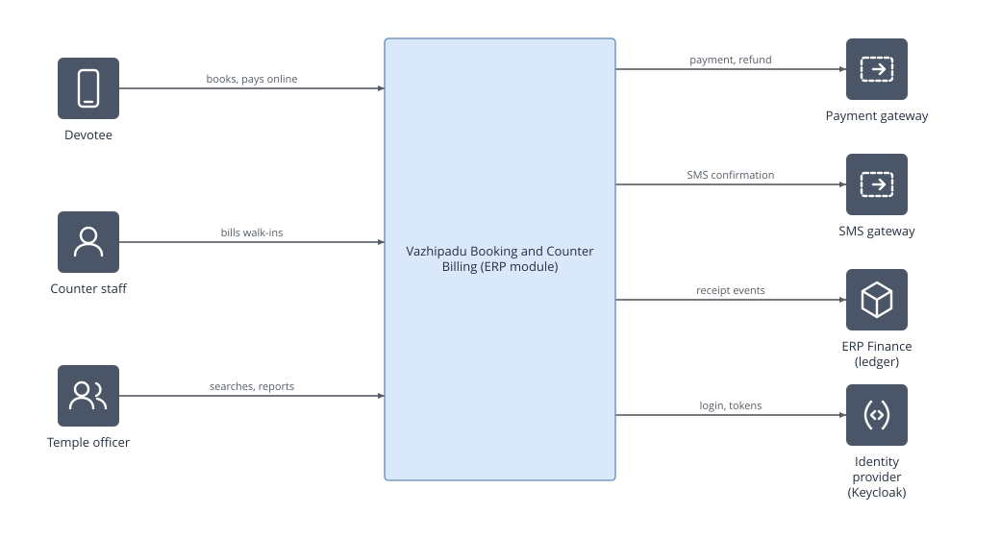
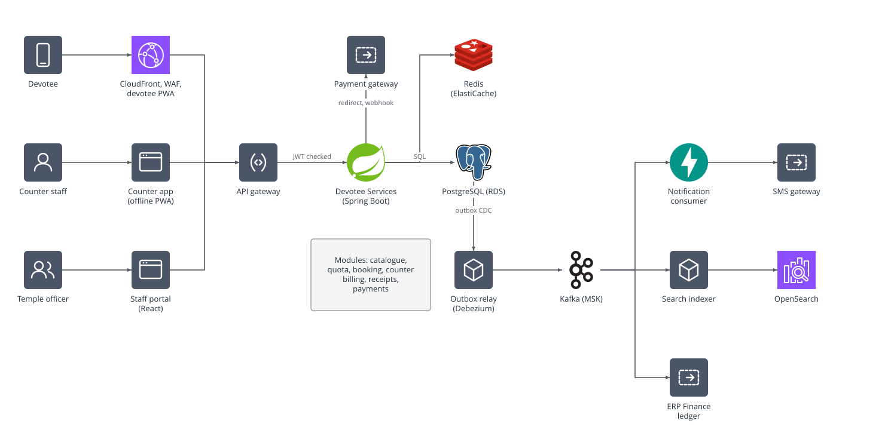
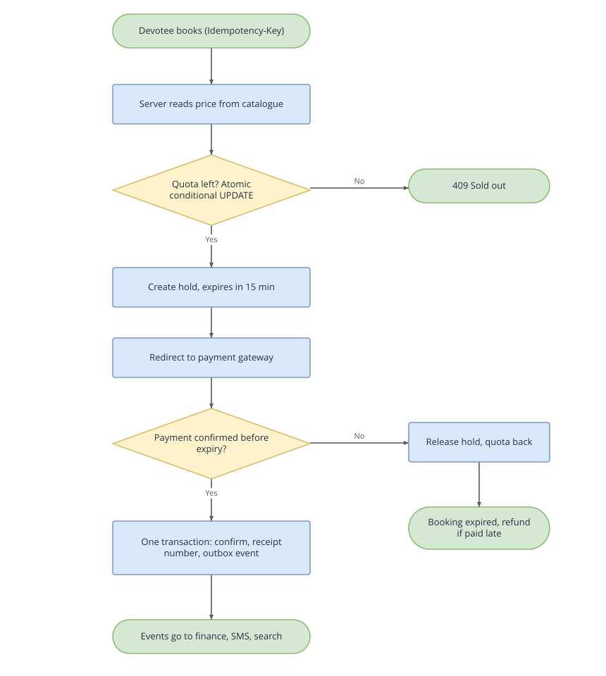
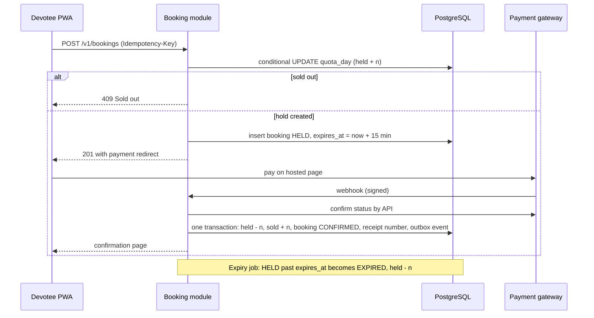
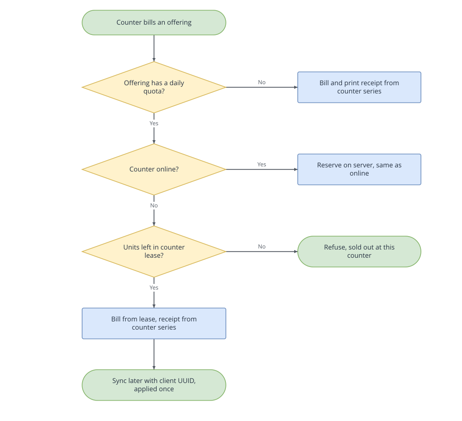
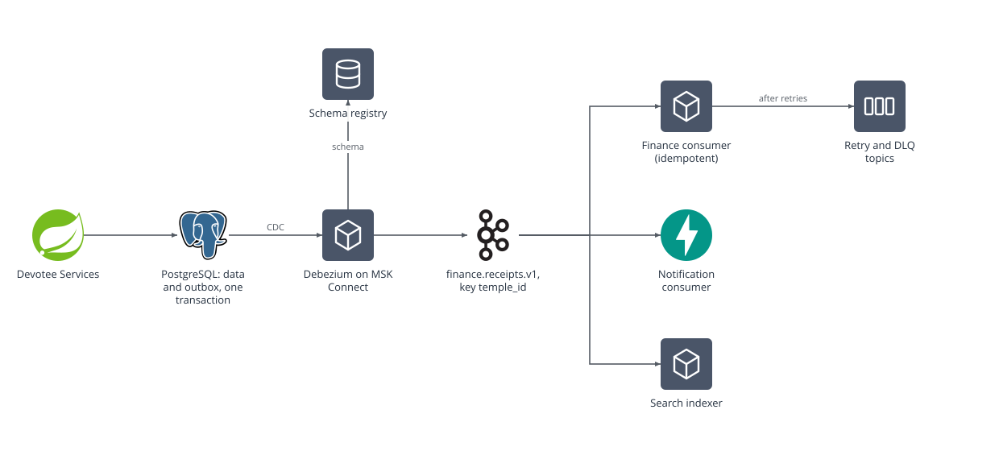
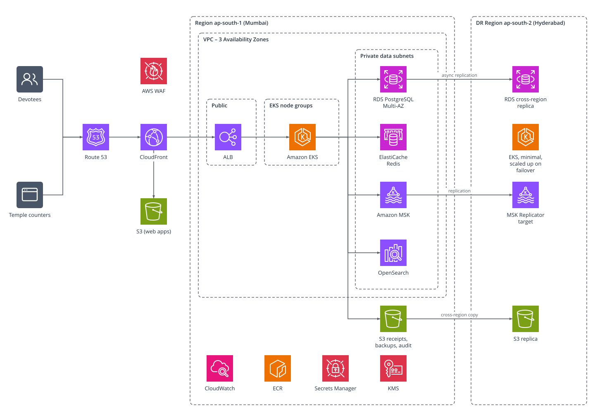

# Architecture – Vazhipadu Booking and Counter Billing

## 1. Assumptions

| # | Assumption |
| --- | --- |
| A1 | Sabarimala peak: **600,000 transactions a day**. 60% fall in the 6 busiest hours, and the busiest minute is 5 times the average |
| A2 | Across all 1,250 temples, the season peak is about **1.2 million transactions a day** |
| A3 | Online booking for popular offerings opens at a fixed time. Up to **200,000 devotees** try within 10 minutes for about **5,000 slots** |
| A4 | Each counter has a PC or tablet with a browser, local storage and a receipt printer. A counter can be offline for up to a full day |
| A5 | The payment gateway offers a hosted checkout page, webhooks, a status API, refunds and a daily settlement file |
| A6 | The ERP provides shared Keycloak, SMS and finance services, and an existing EKS platform |
| A7 | Data must stay in India. Both AWS regions used (Mumbai and Hyderabad) are in India |

## 2. Context (C4 level 1)



| Actor or system | Interaction |
| --- | --- |
| Devotee | Books and pays online on a phone, and gets an SMS |
| Counter staff | Bill walk-in devotees and print receipts, including when offline |
| Temple officer | Searches bookings, sees collections, manages offerings and quotas |
| Payment gateway | Hosted checkout, webhooks, refunds, settlement file |
| SMS gateway | Confirmations in Malayalam or English |
| ERP Finance | Receives receipts and refunds as Kafka events and posts them to the ledger |
| Identity provider (Keycloak) | Login for devotees (mobile OTP) and staff; issues tokens |

## 3. Containers (C4 level 2)



| Container | Technology | Responsibility |
| --- | --- | --- |
| Devotee PWA | React, TypeScript, Tailwind, served from S3 and CloudFront | Mobile-first booking in Malayalam and English; low data use |
| Counter app | React PWA with a service worker and IndexedDB | Keyboard-first billing; works offline; syncs when back online |
| Staff portal | React | Search, reports, offering and quota setup |
| API gateway | Kong or Spring Cloud Gateway on EKS, behind an ALB | Token validation, rate limits, request size limits, routing |
| **Devotee Services** | Java 21, Spring Boot 3, Spring Modulith | The modular monolith: catalogue, quota, booking, counter billing, receipts, payments |
| Outbox relay | Debezium on MSK Connect | Publishes outbox rows to Kafka |
| Notification consumer | Python, FastAPI | SMS templates and languages; calls the shared SMS service |
| Search indexer | Java or Python consumer | Builds OpenSearch indexes from booking events |
| PostgreSQL | Amazon RDS for PostgreSQL 16, Multi-AZ | The source of truth for quota, bookings and receipts |
| Redis | Amazon ElastiCache | Catalogue cache, sold-out flags, rate-limit counters |
| Kafka | Amazon MSK | Events to finance, notifications and search |
| OpenSearch | Amazon OpenSearch Service | Booking search and operational dashboards |

### Why a modular monolith first

Quota, booking, counter billing and receipts change together and must be consistent with each other. One deployable with strict module boundaries gives local transactions where they matter, and keeps the option to split later.

- **Module boundaries:** each module owns its own schema, no module reads another's tables, and modules talk through internal APIs or events. Spring Modulith tests enforce this.
- **Split out when:**
  - a module needs to scale differently (counter sync during the season);
  - a separate team owns it;
  - it must be released on its own.

  The likely first candidate is counter sync.
- **Language choice:** Java for the transactional core, because the ERP's finance-grade services are Java and the tooling is strong. Python for the notification consumer, because it needs template work and is where AI features (a devotee help assistant, for example) will come later. Both follow the same standards: OpenAPI contracts, OIDC tokens, OpenTelemetry, Helm charts and the same CI pipeline.

## 4. Shared quota design

### The model

Each quota-limited offering has one row per temple, offering and date:

| Column | Meaning |
| --- | --- |
| `capacity` | Total performances allowed that day |
| `held` | Online holds waiting for payment |
| `sold` | Confirmed bookings, online and counter |
| `leased` | Units handed to counters for offline use |

The rule that prevents overselling is enforced in the database:

```sql
UPDATE quota_day
   SET held = held + :n
 WHERE temple_id = :t AND offering_id = :o AND service_date = :d
   AND sold + held + leased + :n <= capacity
RETURNING capacity - sold - held - leased AS remaining;
-- 0 rows updated means sold out: return 409
```

The update is atomic, needs no application lock, and is kept in a short transaction of its own, with no network calls inside it.

### Online booking with a hold





- **Orchestration, not choreography,** for this flow. The booking module runs the state machine (`HELD`, `CONFIRMED`, `EXPIRED`, `CANCELLED`, `REFUNDED`) because quota and payment must stay consistent. Downstream work (finance, SMS, search) is choreographed through events.
- **Payment after the hold expires:** if quota is still free, confirm. If not, refund automatically and tell the devotee by SMS.
- **The webhook can't be trusted alone:** the signature is checked and the status is confirmed by a server-to-server call. A daily reconciliation against the settlement file catches anything missed.

### The rush when booking opens

At the rush, 200,000 people chase 5,000 slots, and the database must not take 200,000 writes on one row.

1. **Waiting room:** a virtual queue at CloudFront admits devotees at a controlled rate, for example 500 a second.
2. **Cached availability:** the availability page is cached for a few seconds at CloudFront and in Redis.
3. **Sold-out gate in Redis:** when the database reports the quota is full, a sold-out flag is set in Redis, and later requests get a 409 without touching the database. Redis is only a filter. If it is wrong, the database still refuses, so it can never cause overselling.
4. **Rate limits:** per mobile number and per IP, at the API gateway.
5. **Short transactions:** the quota update holds the row lock for a few milliseconds. Even at 500 updates a second on one row, PostgreSQL copes.

### Offline counters



- **Offerings with no quota** (most of them) can always be billed offline.
- **Quota-limited offerings:** when online, the counter reserves on the server exactly like an online booking. To keep working offline, each counter holds a **lease**, a small block of units (for example 5) moved from the shared quota to that counter. Offline, the counter can only sell from its lease.
- **Returning leases:** unsold lease units return to the shared pool when the counter syncs, or automatically at a cut-off, for example 2 hours before the pooja. The temple configures the lease size per offering.
- **Sync:** each offline bill carries a client-generated UUID, the device ID and a local timestamp. The server applies each UUID once, so a sync can be retried safely.
- **Trade-off:** units in a lease can't be sold online, so an offering can show "sold out" online while a counter still has units. A small lease and an early cut-off keep this small. The temple decides the balance.

## 5. Receipts and events

### Gap-free receipt numbers

- **Format:** `{TEMPLE}/{FY}/{SEQ}`, for example `SBM/2026-27/0012345`. The financial year runs April to March.
- **Online and connected counters:** the number is taken from a counter table in the **same transaction** as the confirmation:

  ```sql
  UPDATE receipt_series SET next_no = next_no + 1
   WHERE temple_id = :t AND fy = :fy
  RETURNING next_no - 1;
  ```

  If the transaction rolls back, the number rolls back too, so there are no gaps. A database sequence would leave gaps. The number is taken only at confirmation, never at the hold, so failed payments don't use numbers.
- **Offline counters:** each counter is given a **block of numbers** from the temple's series in advance (for example 200). An offline bill uses the next number in its block. Unused numbers at the end of the day are recorded as **void entries**, so the series has no unexplained gaps. This keeps one series per temple, as finance requires. Finance and the auditors must accept void entries, and this is an open question for them (see ADR-003).
- **Reprints** are marked "Duplicate". Receipts are never deleted. A cancellation creates a reversal entry with its own reference.

### Kafka design



| Topic | Key | Events | Consumers |
| --- | --- | --- | --- |
| `finance.receipts.v1` | `temple_id` | `ReceiptIssued`, `RefundIssued`, `ReceiptVoided` | ERP Finance |
| `devotee.booking.v1` | `booking_id` | `BookingConfirmed`, `BookingCancelled`, `BookingExpired` | Notification, Search indexer |

- **Keys and ordering:** keying receipts by `temple_id` keeps each temple's receipts in order for the ledger. Sabarimala will be a hot partition, but at about 100 events a second it is well within one partition's capacity. If it ever isn't, the key can become `temple_id` plus counter, and ordering is then kept per series.
- **Topic settings:** 12 partitions, replication factor 3, `min.insync.replicas` 2, producers with `acks=all`, retention 7 days.
- **Reliable publishing:** the **transactional outbox**. The business change and an outbox row are written in one database transaction, and Debezium publishes the outbox row to Kafka. There's no dual write, so an event is never lost or sent for a change that rolled back.
- **Schemas:** JSON Schema or Avro in a schema registry (Apicurio on EKS, for portability), with backward-compatible changes only. A breaking change gets a new topic version (`v2`).
- **Duplicates:** delivery is at least once. Each consumer records `event_id` in a `processed_events` table **in the same transaction** as its own change, and skips any event it has already seen. That gives effectively-once processing. Kafka's exactly-once transactions don't cover the consumer's database, so they aren't relied on.
- **Failures:** retry topics (after 1 minute, then 10 minutes, then 1 hour), then a dead-letter topic with an alert and a replay tool. If finance is down, events wait in Kafka within the retention period. Nothing is lost.

**`ReceiptIssued` payload (example):**

```json
{
  "event_id": "7f1c2a9e-6d1b-4c47-9a39-1f0c2b8e4d55",
  "event_type": "ReceiptIssued",
  "occurred_at": "2026-11-20T06:42:11+05:30",
  "temple_id": "SBM",
  "receipt_no": "SBM/2026-27/0012345",
  "financial_year": "2026-27",
  "booking_ref": "BK-9F3K2Q",
  "channel": "COUNTER",
  "counter_id": "SBM-C07",
  "lines": [{ "offering_code": "PUSHPANJALI", "quantity": 2, "amount_paise": 6000 }],
  "total_paise": 6000,
  "payment": { "mode": "UPI", "reference": "UPI-41827733" }
}
```

Amounts are in paise (integers), so there are no rounding errors. The payload carries no devotee name or phone number, because finance doesn't need them.

## 6. Data architecture

| Table (schema) | Key points |
| --- | --- |
| `catalogue.offering`, `catalogue.price` | Per temple; prices with valid-from and valid-to dates, so history is kept |
| `quota.quota_day`, `quota.counter_lease` | One row per temple, offering and date; leases per counter |
| `booking.booking`, `booking.booking_line` | Partitioned by month on `service_date` |
| `receipts.receipt`, `receipts.receipt_series`, `receipts.void_entry` | Partitioned by financial year; append-only |
| `outbox.event`, `processed_events` | Outbox, and duplicate detection for consumers |
| `audit.audit_log` | Who did what and when, for every change; append-only |

- **Multi-tenancy: shared schema with `temple_id` on every row, and PostgreSQL row-level security.** The temple comes from the user's token. With 1,250 temples, a schema per temple would mean 1,250 copies of every migration and connection pool, with no real benefit. The one temple that is far bigger than the rest, Sabarimala, can be moved to its own database later if needed. The data model already allows it.
- **Partitioning:** bookings by month and receipts by financial year. Old partitions are detached and archived, and queries stay fast.
- **Audit:** an append-only audit table, plus change data capture to S3 with Object Lock, so the record can't be changed. This supports audit by the CAG.
- **Read load:** a read replica for reports and the staff portal. OpenSearch for search and dashboards.
- **OpenSearch:** booking search by receipt number, phone and name, including names in Malayalam (ICU analyser). Monthly indexes behind an alias, with lifecycle management: hot for 3 months, then warm, then deleted when the retention period ends. Application logs go to a separate domain.
- **Redis:** the catalogue cache, sold-out flags and rate-limit counters only. Nothing in Redis is the source of truth. Idempotency keys are stored in PostgreSQL, so they survive a cache restart.

## 7. AWS deployment



- **Regions:** primary ap-south-1 (Mumbai), across 3 availability zones; disaster recovery in ap-south-2 (Hyderabad). Both are in India.
- **Network:**
  - **Public subnets:** the ALB and NAT gateways.
  - **Private app subnets:** EKS node groups.
  - **Private data subnets:** RDS, ElastiCache, MSK and OpenSearch.
  - **Isolation:** security groups allow only the paths shown, and there is no public access to data stores.
- **Edge:** Route 53, CloudFront with AWS WAF (managed rules, rate rules, geo rules if needed), and S3 for the web apps.
- **Accounts:** AWS Organizations, with separate accounts for production, non-production, shared services, and security and log archive, plus Service Control Policies that block unused regions.
- **Secrets and keys:** Secrets Manager for credentials, KMS for encryption at rest, and IAM roles for service accounts (no static keys in pods).
- **CI/CD:** GitHub Actions, images in ECR, and deployment with Helm or Argo CD.

### Disaster recovery

| Layer | High availability (one region) | Disaster recovery (second region) |
| --- | --- | --- |
| PostgreSQL | RDS Multi-AZ | Cross-region read replica, promoted on failover |
| Kafka | MSK across 3 AZs | MSK Replicator to the DR cluster |
| S3 | Within the region | Cross-region replication |
| EKS | Pods spread across AZs, PodDisruptionBudgets | A minimal cluster from the same Terraform, scaled up on failover |
| Traffic | ALB across AZs | Route 53 failover records |

**Targets:** RPO 5 minutes, and RTO 1 hour for a full region loss. Losing one AZ causes no data loss and recovers in minutes. The failover runbook is tested every quarter. Counters keep working during a failover because they are offline-capable, which reduces the impact.

### Portability to a MeitY-empanelled cloud

The core uses open components that every major MeitY-empanelled cloud can run: Kubernetes and Helm, PostgreSQL, Kafka, Redis, OpenSearch, Keycloak, Debezium and Apicurio. AWS-only services (CloudFront, WAF, Route 53, managed services) sit behind Terraform modules that can be swapped. No core logic depends on Lambda, DynamoDB or Step Functions.

## 8. Security

| Area | Design |
| --- | --- |
| Identity | Keycloak (ADR-006). Devotees log in with a mobile OTP. Staff log in with a username and password plus a second factor; officers and finance users need MFA |
| Access | Roles (`counter_clerk`, `temple_manager`, `devaswom_officer`, `finance`) plus attributes: the `temple_ids` claim limits staff to their own temples, enforced in the API and by row-level security |
| Counter devices | Each counter device is registered and has its own key. Offline bills are signed with the device key and checked on sync. Offline sessions use a local PIN, because tokens can't be refreshed without a network |
| API | Tokens checked at the gateway and in the service; rate limits; input validation; OWASP ASVS Level 2 as the standard |
| Payments | The gateway's hosted checkout, so card data never reaches TDB systems. This keeps PCI-DSS scope to the smallest level (SAQ A). Webhooks are signature-checked, and the status is confirmed by API |
| Personal data (DPDP Act 2023) | Only name, mobile number and nakshatra are collected, with no Aadhaar. A notice in Malayalam and English. Mobile numbers encrypted in the database, masked in the UI and logs. Personal data removed or anonymised 1 year after the service date, while finance records keep only the booking reference. Access to personal data is logged |
| Encryption | TLS 1.2 or later everywhere; KMS encryption for RDS, S3, MSK, OpenSearch and EBS |
| CERT-In | Logs kept for 180 days in India; an incident runbook that meets the 6-hour reporting rule; GuardDuty and Security Hub enabled |
| Threat model | STRIDE for the main flows. The biggest threats are bots and touts grabbing quota (waiting room, rate limits, per-mobile limits), forged offline bills (device signatures), and a forged payment webhook (signature plus status check) |

## 9. NFRs and capacity

### NFR table

| NFR | Target |
| --- | --- |
| Availability, online booking | 99.9% per month in the season |
| Counter billing | 100% able to bill, through offline mode |
| Latency | Booking API p95 under 500 ms; availability p95 under 200 ms; a counter receipt printed in under 3 seconds |
| Throughput | 100 bookings a second sustained at the Sabarimala peak; 2,000 availability reads a second; the opening rush shaped by the waiting room |
| RPO and RTO | 5 minutes and 1 hour for a region loss; 0 and 5 minutes for an AZ loss |
| Consistency | No oversold quota, ever; gap-free receipts per temple per financial year |
| Accessibility and language | WCAG 2.2 AA; Malayalam and English in all devotee and counter screens |
| Audit | Every change attributable to a user or device; nothing deleted |
| Observability | OpenTelemetry traces; dashboards for holds, sales, sold-out offerings, outbox lag, consumer lag, dead-letter topic depth and counter sync backlog |

### Capacity estimate (Sabarimala peak)

| Item | Working | Result |
| --- | --- | --- |
| Busy-hour bookings | 600,000 × 60% ÷ 6 hours | 60,000 an hour, about 17 a second |
| Busiest minute | 17 × 5 | About **85 bookings a second** (design for 100) |
| Database writes | About 5 writes per booking (quota, booking, lines, receipt, outbox) | About 500 writes a second: comfortable for RDS `db.r6g.2xlarge` |
| Storage | 1.2 million transactions a day across temples × about 3 KB | About 3.6 GB a day at peak; a few hundred GB a year before archiving |
| Kafka | About 100 events a second × 1 KB | Very small for MSK; partitions sized for consumer parallelism, not volume |
| Booking pods | About 100 requests a second per pod, 2× headroom | 6 pods normally; HPA from 6 to 30 |
| Database connections | 30 pods × pool of 20 = 600 | Kept below the RDS limit through RDS Proxy or PgBouncer, so scaling out can't exhaust connections |
| The opening rush | 200,000 devotees in 10 minutes | About 330 a second arrive; the waiting room admits about 500 a second, and the sold-out gate stops database load once the slots are gone |

Before each season, a k6 load test runs at twice this peak on a copy of production.

## 10. Architecture decision records

### ADR-001 – A modular monolith for Devotee Services

- **Context:** quota, booking, counter billing and receipts must stay consistent, and one team builds them.
- **Options:** microservices from the start; a modular monolith; a classic layered monolith.
- **Decision:** a modular monolith with enforced module boundaries, one schema per module, and events between modules.
- **Consequences:**
  - Local transactions for quota and receipts.
  - Fewer moving parts in the first season.
  - Modules must be kept separate with discipline; Spring Modulith tests guard this.
  - Splitting counter sync out later is planned.

### ADR-002 – PostgreSQL is the authority for quota, Redis is only a filter

- **Context:** the quota must never be oversold, and the opening rush is very large.
- **Options:** counters in Redis as the authority; PostgreSQL row locks with `SELECT ... FOR UPDATE`; an atomic conditional `UPDATE` in PostgreSQL, with Redis as a sold-out gate.
- **Decision:** the conditional `UPDATE` in PostgreSQL, with a waiting room and a Redis sold-out flag in front.
- **Consequences:**
  - Overselling is impossible even if Redis is wrong or lost.
  - The database row is a hot spot at the rush, which is handled by the waiting room, short transactions and the gate.
  - A Redis-only design would be faster, but it would risk losing data on failover and needs a second write to the database (a dual write).

### ADR-003 – Offline counters use quota leases and pre-allocated receipt blocks

- **Context:** counters must work offline for hours, while quota and receipt numbers are shared.
- **Options:** block billing when offline; allow unlimited offline billing and fix conflicts later; leases and pre-allocated blocks.
- **Decision:** leases for quota-limited offerings, and receipt number blocks from the temple's single series, with unused numbers voided at the end of the day.
- **Consequences:**
  - Counters always work, and quota can't be oversold.
  - Leased units are hidden from online devotees until they are returned.
  - Void entries need finance and audit approval. If finance refuses void entries, the fallback is a separate series per counter (`SBM/2026-27/C07/0001`), which needs approval too.

### ADR-004 – A transactional outbox with Debezium for events

- **Context:** finance must receive every receipt exactly as recorded, with no loss and no phantom events.
- **Options:** publish to Kafka in application code after commit (a dual write); a polling publisher; an outbox with Debezium change data capture.
- **Decision:** an outbox table with Debezium on MSK Connect.
- **Consequences:**
  - No lost or phantom events.
  - Low latency.
  - Debezium has to be run and monitored (replication slot lag).
  - Consumers must still handle duplicates.

### ADR-005 – Shared schema with row-level security for 1,250 temples

- **Context:** 1,250 temples of very different sizes, and staff must see only their own temples.
- **Options:** a database per temple; a schema per temple; a shared schema with `temple_id` and row-level security.
- **Decision:** a shared schema with row-level security, keeping the option to move a very large temple to its own database.
- **Consequences:**
  - One set of migrations and connection pools.
  - Cross-temple reports are easy.
  - Every query must carry the temple context; row-level security and tests guard against leaks between temples.

### ADR-006 – Keycloak rather than Amazon Cognito

- **Context:** identity for devotees and staff, with the design portable to a MeitY-empanelled cloud.
- **Options:** Cognito; Keycloak on EKS.
- **Decision:** Keycloak, run in high-availability mode on EKS with its own PostgreSQL.
- **Consequences:**
  - Portable and flexible: OTP flows, attribute claims and federation.
  - The team must run, patch and scale it, and it is critical: if it is down, nobody can log in. It is mitigated by multiple replicas across AZs, and counters can still bill offline.

## 11. Top risks

| # | Risk | Mitigation |
| --- | --- | --- |
| R1 | The opening rush overwhelms the platform, or bots and touts take the quota | Waiting room, sold-out gate, rate limits and per-mobile limits, CAPTCHA on suspicious traffic, a load test before the season |
| R2 | Offline lease and receipt-block rules are disputed by temples, finance or audit | Agree the rules with finance and audit before building; configurable lease sizes; reports on unsold lease units and void entries |
| R3 | Payment gateway webhooks are late or lost, leaving devotees charged but unconfirmed | Status API checks, daily settlement reconciliation, automatic refund for late payments, a support view for staff |
| R4 | Identity (Keycloak) or the database fails at the peak | Multi-AZ, replicas, tested failover, offline counters; game days before the season |
| R5 | Personal data is exposed, through search, logs or over-broad staff access | Data minimisation, masking, temple-scoped access, access logs, regular access reviews, a DPDP review before go-live |
